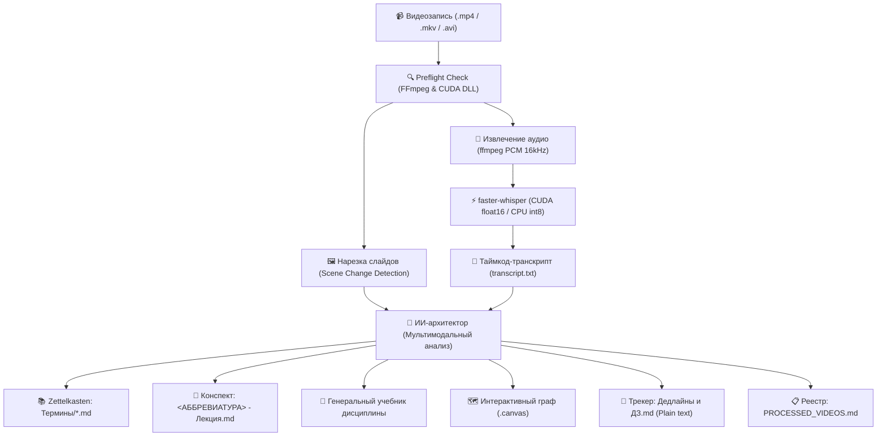

<div align="center">

# 🎙️ Obsidian Lecture Transcriber & Knowledge Base Automator

**Автономный программный комплекс для локальной транскрибации лекций с аппаратным ускорением на GPU (NVIDIA CUDA 12, cuDNN 9) и интеллектуальной интеграцией базы знаний в Obsidian Vault.**

[](https://www.python.org/)
[](https://developer.nvidia.com/cuda-toolkit)
[](https://github.com/SYSTRAN/faster-whisper)
[](https://obsidian.md/)
[](https://peps.python.org/pep-0621/)
[](tests/)
[](LICENSE)

</div>

---

## 🌟 Ключевые возможности

- ⚡ **Аппаратное ускорение на GPU (NVIDIA CUDA 12 / cuDNN 9):**
  - Движок `faster-whisper` на базе оптимизированного бэкенда `CTranslate2` обеспечивает распознавание речи в 4–8 раз быстрее реального времени на видеокартах GeForce RTX.
  - Автоматический fallback на CPU (`int8`) при отсутствии или сбое графического ускорителя.

- 🖥️ **Современный десктопный GUI (CustomTkinter):**
  - Адаптивный графический интерфейс с поддержкой тёмной/системной темы Windows 11.
  - Потокобезопасная асинхронная обработка (Tcl/Tk UI-диспетчер `self.after`).
  - Пакетная очередь видеозаписей, потоковый лог прогресса с точностью до секунды и автоматическая выгрузка копий конспектов в системную папку «Загрузки».

- 👁️ **Интеллектуальная детекция слайдов (Scene Change Detection):**
  - Адаптивный фильтр `ffmpeg` извлекает только фактические смены кадров презентации (`scene > 0.05`), предотвращая засорение хранилища сотнями дублирующихся скриншотов.
  - Гарантированный срез опорных кадров каждые 120 секунд при статичном экране.

- 🧠 **Сквозная интеграция в Obsidian Vault (Zero Broken Links Protocol):**
  - **Zettelkasten-понятия:** пополнение атомарных определений в папке `Термины/` с метаданными Dataview.
  - **Академический KaTeX LaTeX:** все математические выкладки, теоремы и формулы оформляются в LaTeX (`$$...$$`).
  - **Монолитные генеральные учебники:** консолидация материала в `Учебник - <Дисциплина>.md` с логической разбивкой по главам.
  - **Интерактивные графы связей (`.canvas`):** автоматическая визуализация знаний (лекции — синие узлы, термины — зелёные узлы).
  - **Изолированный трекер дедлайнов:** фиксация ДЗ и рубежных контролей в `Дедлайны и ДЗ.md` без паразитного связывания графа.
  - **Active Recall:** блок вопросов для самопроверки и экзамена с ответами под спойлерами `> [!question]- Ответ`.

---

## 🎯 Целевой скоуп дисциплин

В активной поддержке и разработке находятся **4 приоритетные дисциплины**:

| № | Дисциплина | Официальный префикс | Пример конспекта |
| :-: | :--- | :---: | :--- |
| 1 | **Математика (Матанализ)** | `МатАн` | `МатАн - Лекция 1. Числовые последовательности.md` |
| 2 | **Дискретная математика** | `ДМ` | `ДМ - Лекция 1. Теория множеств и отношения.md` |
| 3 | **Анализ данных и ИИ** | `АДиИИ` | `АДиИИ - Лекция 1. Вводная пара.md` |
| 4 | **Алгебра, геометрия и ТДУ** | `АГиТДУ` | `АГиТДУ - Лекция 1. Комплексные числа.md` |

---

## 🏗️ Архитектура конвейера обработки



---

## 📁 Структура репозитория

```text
recording/
├── src/
│   ├── __init__.py                 # Пакетная инициализация и публичный API
│   ├── cuda_utils.py               # Безопасное подключение бинарников NVIDIA CUDA/cuDNN в Windows
│   └── extract.py                  # Ядро: preflight-чек, нарезка кадров, аудио и транскрибация
├── docs/
│   └── architecture/
│       ├── pipeline.md             # Регламент сквозного мультимодального конвейера
│       └── obsidian_vault.md       # Спецификация базы знаний, Zettelkasten и Canvas
├── tests/
│   ├── __init__.py                 # Модуль тестового пакета
│   ├── test_smoke.py               # Комплексный сьют дымовых тестов целостности
│   └── test_extract.py             # Модульные тесты сервисного слоя и мок-проверки ffmpeg
├── app_gui.py                      # Потокобезопасный GUI на CustomTkinter
├── Запустить_Транскрибатор.bat      # Ярлык быстрого запуска GUI для Windows в один клик
├── AGENTS.md                       # Единый поведенческий контракт ИИ-агентов (стандарт 2026)
├── PROCESSED_VIDEOS.md             # Реестр обработанных лекций по 4 целевым дисциплинам
├── TASK.md                         # Living Project State Tracker (актуальный статус и бэклог)
├── pyproject.toml                  # Декларативная спецификация проекта (PEP 621)
├── requirements.txt                # Фиксация зависимостей для uv/pip
└── .gitignore                      # Исключения медиакэшей, артефактов и окружения
```

---

## 🚀 Быстрый старт

### Системные требования
- **ОС:** Windows 10/11 (x64)
- **Python:** 3.12 или новее
- **Пакетный менеджер:** [uv](https://github.com/astral-sh/uv) (рекомендуется)
- **FFmpeg:** системный исполняемый файл `ffmpeg` в `PATH`
- **GPU (опционально):** NVIDIA GeForce RTX с драйвером CUDA 12 и cuDNN 9

### 1. Клонирование и установка зависимостей
```powershell
git clone https://github.com/Gupkagrop/recording.git
cd recording

# Создание виртуального окружения и синхронизация пакетов:
uv sync
# Или через pip:
uv pip install -r requirements.txt
```

### 2. Настройка окружения
```powershell
copy .env.example .env
```

---

## 💻 Запуск и использование

### Вариант 1: Графический интерфейс (GUI)
Двойной клик по батнику:
```powershell
.\Запустить_Транскрибатор.bat
```
Либо через консоль:
```powershell
uv run python app_gui.py
```
1. Нажмите **«Выбрать видео...»** и укажите файлы лекций (поддерживаются `.mp4`, `.mkv`, `.avi`, `.mov`, `.webm`).
2. Выберите каталог для сохранения конспектов.
3. Нажмите **«НАЧАТЬ ОБРАБОТКУ»**. Процесс будет выполняться асинхронно без зависания интерфейса с поминутным логом распознавания речи.

### Вариант 2: Консольный пайплайн (CLI)
```powershell
uv run python src/extract.py "C:\Path\To\Lecture.mp4"
```
Результаты сохраняются в структурированный каталог `cache/<video_basename>/`:
- `audio.wav` — извлечённая PCM-аудиодорожка (16 кГц, моно).
- `transcript.txt` — полный текст с временными метками `[MM:SS]`.
- `frames/` — ключевые кадры слайдов презентации.

---

## 🧪 Тестирование и верификация

Запуск полного сьюта модульных и дымовых тестов (11 тестов):
```powershell
uv run python -m unittest discover tests
```

Синтаксическая проверка компиляции:
```powershell
uv run python -m py_compile app_gui.py src/*.py tests/*.py
```

Сборка AST-карты кодовой базы:
```powershell
npx repomix
```

---

## 📄 Лицензия

Проект лицензирован под свободной лицензией **MIT**. Подробности в файле [LICENSE](LICENSE).
