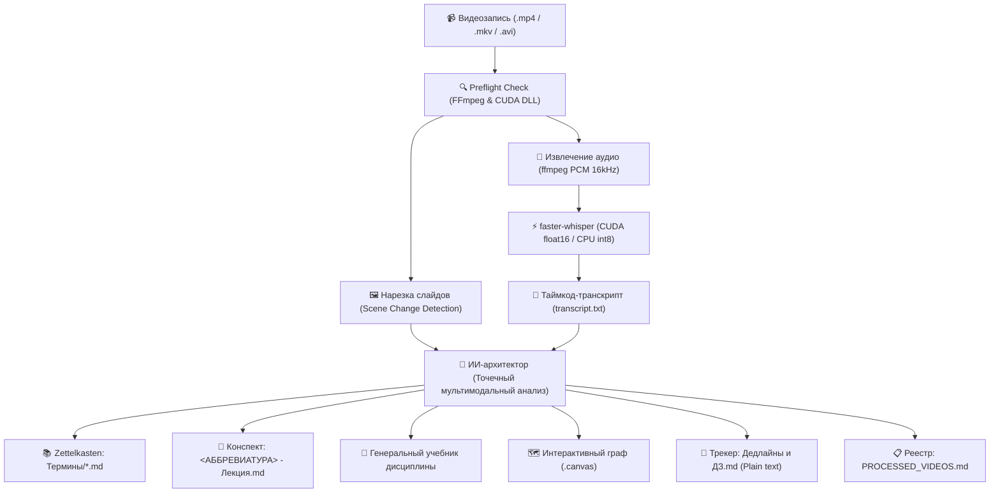

<div align="center">

# 🎙️ GupkaScribe Studio (Obsidian Lecture Automator)

**Автономная мультимодальная фабрика конспектов и базы знаний под управлением ИИ-агентов (Antigravity) со встроенным эргономичным десктопным пультом для локальной транскрибации (NVIDIA CUDA 12, cuDNN 9).**

[](https://www.python.org/)
[](https://developer.nvidia.com/cuda-toolkit)
[](https://github.com/SYSTRAN/faster-whisper)
[](https://obsidian.md/)
[](.agents/skills/)
[](tests/)
[](LICENSE)

</div>

---

## 🏛️ Двухуровневая архитектура (AI-First Philosophy)

Проект спроектирован с чётким разделением приоритетов:

1. **🤖 Tier 1 (Основной контур — AI Agent Orchestration):**
   - Автономный конвейер под управлением интеллектуальных ИИ-агентов (Google Antigravity, Gemini CLI).
   - Точечный мультимодальный анализ слайдов по таймкодам транскрипта без переполнения контекста.
   - Пополнение карточек понятий Zettelkasten (`Термины/*.md`), синтез глав генеральных учебников, построение графов связей Canvas и реестра дедлайнов.
   - Специализированные воркспейс-скилы: [lecture-processor](file:///.agents/skills/lecture-processor/SKILL.md) и [vault-curator](file:///.agents/skills/vault-curator/SKILL.md).

2. **🖥️ Tier 2 (Вспомогательный контур — Auxiliary Desktop Studio):**
   - Полнофункциональный графический интерфейс на `CustomTkinter` с тёмной темой Windows 11.
   - Пакетная транскрибация видеозаписей пользователем вручную, выбор пресетов Whisper, умная детекция слайдов, мониторинг базы знаний и аппаратная телеметрия GPU.

---

## 🎯 Универсальный движок курсов (Universal Course Engine)

Платформа **GupkaScribe** полностью открыта и готова к масштабированию под любые учебные курсы и лекции (технические, IT, естественно-научные, гуманитарные). При появлении новой дисциплины агент динамически создаёт предметную директорию, Zettelkasten-термины и граф связей.

### Активный университетский семестр (Базовый профиль):

| № | Дисциплина | Официальный префикс | Статус в Obsidian | Пример конспекта |
| :-: | :--- | :---: | :---: | :--- |
| 1 | **Математика (Матанализ)** | `МатАн` | Активен (64 файла) | `МатАн - Лекция 1. Числовые последовательности.md` |
| 2 | **Дискретная математика** | `ДМ` | Активен (67 файлов) | `ДМ - Лекция 1. Теория множеств и отношения.md` |
| 3 | **Анализ данных и ИИ** | `АДиИИ` | Активен (32 файла) | `АДиИИ - Лекция 1. Вводная пара.md` |
| 4 | **Алгебра, геометрия и ТДУ** | `АГиТДУ` | Готов к наполнению | `АГиТДУ - Лекция 1. Комплексные числа.md` |

---

## ⚡ Аппаратные и технологические возможности

- 🚀 **Ускорение на GPU (NVIDIA CUDA 12 / cuDNN 9):**
  - Движок `faster-whisper` на базе CTranslate2 обеспечивает инференс в 4–8 раз быстрее реального времени.
  - Плавный fallback на CPU (`int8`) при недоступности видеокарты или нехватке VRAM.
- 👁️ **Scene Change Detection (Умная нарезка слайдов):**
  - Фильтр `ffmpeg` фиксирует реальные смены слайдов презентации (`scene > 0.05`), предотвращая захламление диска тысячами дублей.
- 🛡️ **Zero Broken Links Protocol & Изоляция графа:**
  - Строгий аудит внутренних ссылок (`verify_link_integrity`) с отсечением псевдонимов и якорей.
  - Полная изоляция `Дедлайны и ДЗ.md` от графа связей Obsidian (запрет wiki-ссылок в обе стороны).

---

## 🏗️ Сквозной конвейер обработки



---

## 📁 Структура репозитория

```text
gupkascribe/
├── .agents/
│   └── skills/
│       ├── lecture-processor/      # Воркспейс-скилл сквозной обработки лекции агентом
│       │   └── SKILL.md
│       └── vault-curator/          # Воркспейс-скилл аудита связей и целостности базы
│           └── SKILL.md
├── src/
│   ├── __init__.py                 # Пакетная спецификация и публичный API
│   ├── cuda_utils.py               # Безопасное подключение бинарников NVIDIA CUDA/cuDNN в Windows
│   ├── extract.py                  # Ядро: preflight, нарезка кадров, аудио и транскрибация
│   └── vault_utils.py              # Сервисный слой аудита хранилища, ссылок и телеметрии
├── docs/
│   └── architecture/
│       ├── pipeline.md             # Регламент сквозного мультимодального конвейера
│       └── obsidian_vault.md       # Спецификация базы знаний, Zettelkasten и Canvas
├── tests/
│   ├── __init__.py                 # Модуль тестового пакета
│   ├── test_smoke.py               # Дымовые тесты структуры и стандартов
│   ├── test_extract.py             # Модульные тесты сервисного слоя экстракции
│   └── test_vault.py               # Герметичные тесты линтера ссылок и телеметрии
├── app_gui.py                      # Вспомогательный десктопный GUI (CustomTkinter)
├── Запустить_Транскрибатор.bat      # Ярлык быстрого запуска GUI для Windows в один клик
├── AGENTS.md                       # Единый поведенческий контракт ИИ-агентов (стандарт 2026)
├── PROCESSED_VIDEOS.md             # Реестр обработанных лекций по 4 целевым дисциплинам
├── TASK.md                         # Living Project State Tracker (актуальный статус и бэклог)
├── pyproject.toml                  # Декларативная спецификация проекта (PEP 621)
├── requirements.txt                # Фиксация зависимостей для uv/pip
└── .gitignore                      # Исключения медиакэшей, артефактов и окружения
```

---

## 🚀 Быстрый старт

### Системные требования
- **ОС:** Windows 10/11 (x64)
- **Python:** 3.12 или новее
- **Пакетный менеджер:** [uv](https://github.com/astral-sh/uv) (рекомендуется)
- **FFmpeg:** системный бинарник `ffmpeg` в `PATH`
- **GPU (опционально):** NVIDIA GeForce RTX с драйвером CUDA 12 и cuDNN 9

### 1. Установка и запуск окружения
```powershell
git clone https://github.com/Gupkagrop/gupkascribe.git
cd gupkascribe

# Синхронизация зависимостей через uv:
uv sync
```

---

## 💻 Варианты работы

### 1. Автономный режим с ИИ-агентом (Рекомендуемый)
ИИ-агент Antigravity автоматически обнаруживает скилы в `.agents/skills/`:
- Для обработки новой лекции скажите агенту: `«Обработай лекцию <путь_к_видео>»` — агент запустит скилл `lecture-processor`, выполнит экстракцию, точечный просмотр слайдов, создаст конспект с формулами KaTeX, пополнит термины и обновит холст Canvas.
- Для проверки хранилища скажите агенту: `«Проверь целостность базы Obsidian»` — агент запустит скилл `vault-curator` и устранит дефекты.

### 2. Вспомогательный десктопный GUI (Для ручной работы)
Двойной клик по батнику `Запустить_Транскрибатор.bat` или в консоли:
```powershell
uv run python app_gui.py
```
- **Вкладка «🎙️ Транскрибатор»:** очередь видеофайлов, выбор модели Whisper (`small`, `base`, `medium`, `large-v3`), переключатель умной детекции сцен, прогресс-бар и интерактивный журнал логов.
- **Вкладка «📚 База знаний»:** карточки 4 активных дисциплин со счетчиками конспектов/терминов, кнопка моментального аудита связей и открытие хранилища в проводнике.
- **Вкладка «⚙️ Телеметрия»:** мгновенная диагностика доступности FFmpeg, видеокарты NVIDIA и статуса готовности агентов.

### 3. Консольный пайплайн (CLI)
```powershell
uv run python src/extract.py "C:\Path\To\Lecture.mp4"
```

---

## 🧪 Тестирование и верификация

Запуск полного сьюта модульных и дымовых тестов (16 тестов):
```powershell
uv run python -m unittest discover tests
```

Синтаксическая проверка компиляции:
```powershell
uv run python -m py_compile app_gui.py src/*.py tests/*.py
```

Сборка AST-карты кодовой базы:
```powershell
npx repomix
```

---

## 📄 Лицензия

Проект лицензирован под свободной лицензией **MIT**. Подробности в файле [LICENSE](LICENSE).
